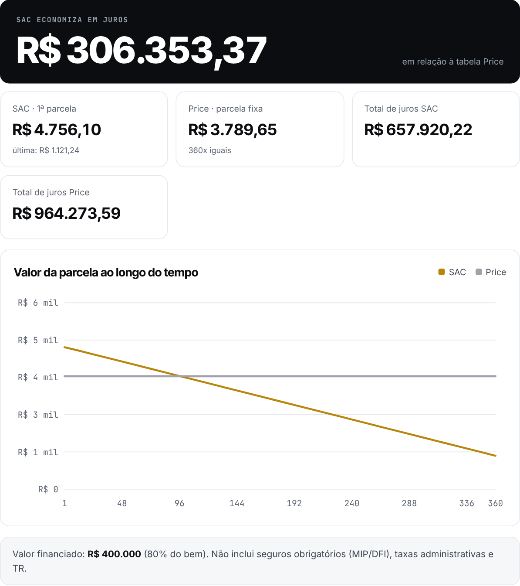
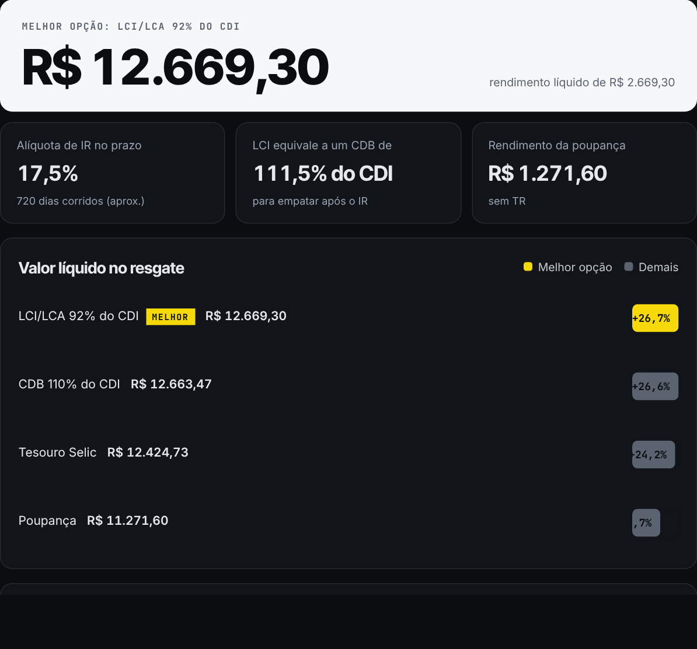
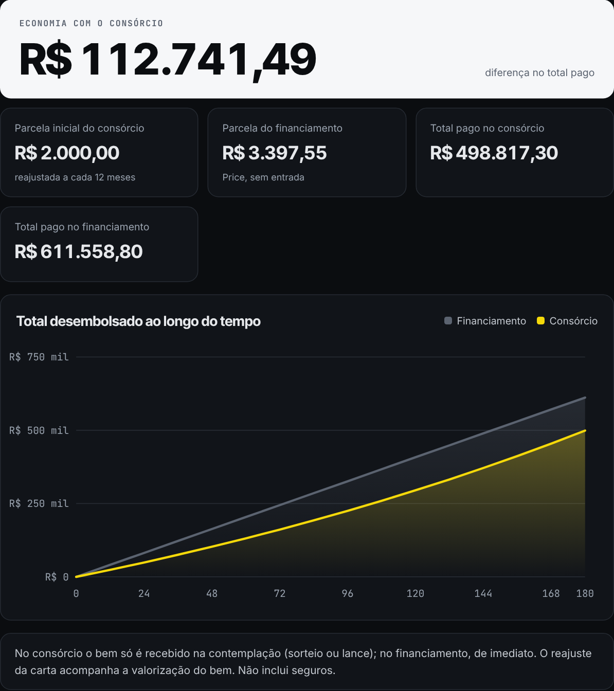
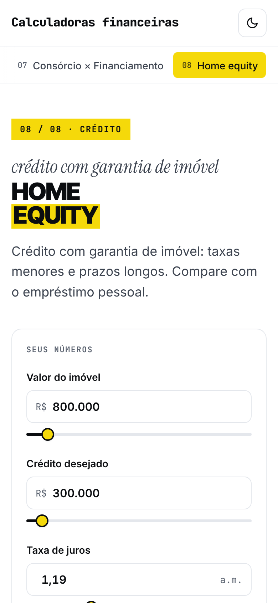

<!-- made by lydson -->
# Calculadoras financeiras

**Acesse:** https://lydson.github.io/calculadoras-financeiras/

Criei estas calculadoras pensando em ajudar as pessoas a cuidarem melhor das próprias finanças. A ideia é ter ferramentas simples, gratuitas e diretas para fazer as contas antes de tomar uma decisão, seja para investir, montar uma reserva ou escolher um financiamento.

## Veja por dentro

| Juros compostos | Financiamento SAC × Price |
|---|---|
|  |  |

| Renda fixa (tema escuro) | Consórcio × Financiamento (tema escuro) |
|---|---|
|  |  |

<em>Também funciona no celular.</em>

## Calculadoras

| # | Calculadora | Para que serve |
|---|---|---|
| 01 | Juros compostos | Ver quanto o dinheiro rende com aportes mensais |
| 02 | Primeiro milhão | Descobrir em quanto tempo você chega à meta e quanto precisa guardar por mês |
| 03 | Comparador de renda fixa | Comparar CDB, LCI/LCA, Tesouro Selic e poupança, já com Imposto de Renda |
| 04 | Reserva de emergência | Calcular a reserva ideal para o seu perfil de trabalho |
| 05 | Independência financeira | Saber quanto patrimônio é preciso para viver de renda |
| 06 | Financiamento SAC × Price | Comparar os dois sistemas de amortização |
| 07 | Consórcio × Financiamento | Ver qual caminho custa menos até o mesmo bem |
| 08 | Home equity | Simular crédito com garantia de imóvel |

## Como usar

Abra o link acima, escolha uma calculadora no menu e preencha os campos. Os resultados e gráficos se atualizam na hora. O site funciona no computador e no celular e tem tema claro e escuro.

Para rodar localmente, basta baixar o `index.html` e abrir no navegador.

## ⚠️ Aviso importante

- Os resultados são **simulações e estimativas**. Eles não são recomendação de investimento, oferta de crédito nem garantia de rentabilidade.
- As taxas padrão (como Selic e CDI) são apenas pontos de partida e podem estar desatualizadas. Confira os valores atuais antes de usar.
- Impostos, taxas, seguros e regras de cada produto podem mudar e variar de instituição para instituição.
- Antes de qualquer decisão importante, consulte um profissional de sua confiança.

**Encontrou algum erro ou tem uma sugestão?** Me avise abrindo uma [issue aqui no GitHub](https://github.com/Lydson/calculadoras-financeiras/issues). Toda ajuda para deixar as calculadoras mais corretas é bem-vinda.

---

made by lydson
